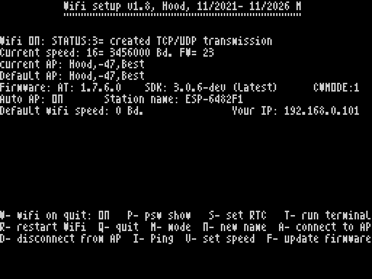

# WiFi Setup

Current release: **1.8**, with separate `ver18/el-mb` and `ver18/zx-next` variants.

## What's New in 1.8

### Common improvements

- Added: **Empty passwords are accepted**, allowing connections to open WiFi networks.
- Added: **I-Ping** to check the reachability of an IP address or hostname.
- Improved: AT-command handling, response parsing, timeouts, escaping, and buffer handling. Trailing spaces in passwords are preserved.
- Added: unsuccessful connection returns you back to Default AP. (Before it left you without being connected to default AP).
- Corrected: SNTP configuration detection when replies contain leading line breaks or command echo.
- Integrated: **WiFi BIOS 2.1** and **WiFi Terminal 1.1**, including command history and the two-line editor.

### EL/MB

- After acknowledging an AP result, the setup follows the same initialization path as returning from the terminal, refreshing UART alignment and the displayed speed.
- A temporary rate of **115200 baud (index 7)** may be shown during Default AP recovery before acknowledgement.

### ZX Next version

- Added a standalone Next port with Next-specific UART, CPU-state handling, and RTC support.
- Supports **15 baud indices (0-14)** without the inherited EL/MB warnings for indices 13 and 14. The display shows `max speed index=14`.
- RTC synchronization asks for a **GMT offset from -12 to +14**. EDIT cancels the input; the result remains visible until a key is pressed.
- ESP remains powered when the setup exits.

Each variant includes sources, required binary components, build scripts, tests, and ready-to-use files in `runable/`. Both include BIOS 2.1 and Terminal 1.1.

The EL/MB package also includes flash and debug binaries. These intentionally contain identical code to allow NMI debugging.

The original `ver17` source archive is preserved unchanged. Development backups and intermediate files were moved to the separate local `Wifi Setup work/ver18` directory and are not included here. Sara is not part of this release.

## Screenshot

WiFi Setup 1.8 on EL/MB. Converted from the original SCR screen at 3x integer scale without smoothing.

## Downloads

Direct, version-specific links suitable for use on other websites:

| Platform / package | Download | Bytes |
|---|---|---:|
| EL/MB standalone TAP | [wifi_setup_standalone18.tap](https://raw.githubusercontent.com/milan-stava/Wifi-setup/v1.8/ver18/el-mb/runable/wifi_setup_standalone18.tap) | 16264 |
| ZX Next standalone TAP | [wifi_setup_next18.tap](https://raw.githubusercontent.com/milan-stava/Wifi-setup/v1.8/ver18/zx-next/runable/wifi_setup_next18.tap) | 16396 |
| EL/MB standalone BIN | [wifi_setup_standalone18.bin](https://raw.githubusercontent.com/milan-stava/Wifi-setup/v1.8/ver18/el-mb/runable/wifi_setup_standalone18.bin) | 16184 |
| EL/MB flash BIN | [wifi_setup_flash18.bin](https://raw.githubusercontent.com/milan-stava/Wifi-setup/v1.8/ver18/el-mb/runable/wifi_setup_flash18.bin) | 16228 |

[Complete v1.8 package ZIP (sources and binaries)](https://github.com/milan-stava/Wifi-setup/archive/refs/tags/v1.8.zip).

The links target the existing release tag, so later development on main does not change these downloads.